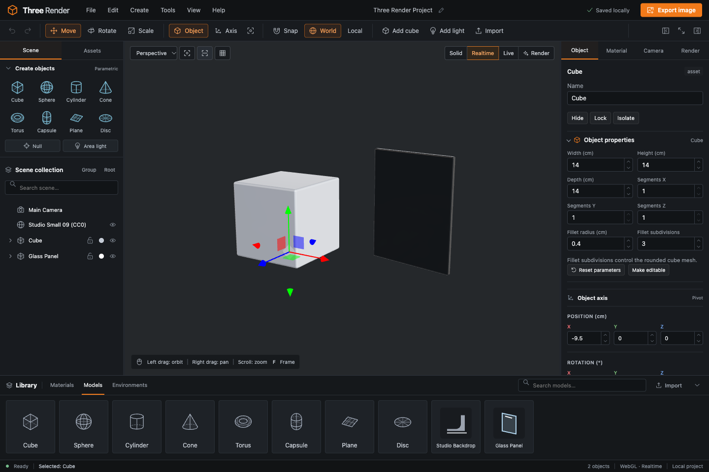

# Three Render

A local-first 3D scene editor for the browser. Assemble scenes, edit physical materials and lighting, and switch between fast interactive previews and progressive path tracing.

**[Open the live editor](https://ntvibe.github.io/three-render/)** — runs entirely in your browser.

Built with React, TypeScript, Three.js, and three-gpu-pathtracer. No account or backend is required. Projects autosave locally in the browser and can be saved as `.studio.json` files.



## Run locally

Use Node.js 22 or newer.

```sh
npm ci
npm run dev -- --host 127.0.0.1 --port 5180 --strictPort
```

Open [localhost:5180](http://127.0.0.1:5180/). WebGL2 and a compatible browser/GPU are required. This is an early desktop-first editor; smaller screens have collapsible panels and compact viewport controls.

## Static hosting

The `Deploy GitHub Pages` workflow publishes the `main` branch at [ntvibe.github.io/three-render](https://ntvibe.github.io/three-render/) after asset checks, regression tests, and a production build. Local development still uses the root URL.

For a local preview of the Pages build:

```sh
npm run build:pages
npm run preview:pages -- --host 127.0.0.1 --port 5184
```

Open `http://127.0.0.1:5184/three-render/`. Built-in assets resolve relative to the hosting prefix; saved project asset references remain portable. Autosave is local to each website origin, so export a project file when moving between localhost and the hosted editor.

## What you can do

- Create eight parametric primitives, empty hierarchy objects, and area/spot/point/sun lights.
- Import GLB, self-contained glTF, HDR, and EXR files.
- Select, rename, duplicate, group, reorder, parent, hide, lock, and isolate scene objects.
- Edit world/local transforms, use snapping and adjustable pivots, and bake primitives into meshes.
- Edit physical materials: roughness, metalness, transmission, IOR, absorption, dispersion, clearcoat, sheen, iridescence, anisotropy, and emission.
- Inspect material usage. Choose **Make Unique** for one element or **Edit Shared** for all users. Locked objects are protected.
- Use perspective/orthographic cameras, axis views, frame selection/scene, and orbit/pan/zoom navigation.
- Switch between Solid, Realtime, Live path tracing, and final Render modes. GPU denoising is optional.
- Export PNG images and GLB geometry/materials/camera. Save a project file to preserve lights, environments, and editable parameters.
- Undo/redo edits and restore projects from local autosave or a project file.

The starter scene contains a ceramic cube and glass panel lit by a bundled CC0 studio HDRI. The library includes two newly generated CC0 models and an environment. Library material spheres are representative swatches.

## Controls

- **W / E / R:** Move / Rotate / Scale.
- **L:** Edit the object's pivot position. Geometry and child world placement stay fixed.
- **F / Shift F:** Frame selection / scene.
- **Cmd or Ctrl D:** Duplicate. **Cmd or Ctrl Z / Shift Z:** Undo / redo.
- **Cmd or Ctrl S / O:** Save / open a project file.
- Hold **1 / 2 / 3** while dragging to pan / dolly / orbit.
- Numeric fields accept arithmetic (`(10+5)*2`), relative values (`+=5`), lengths (`20mm`, `0.5m`), and angles (`1rad`). Drag or use arrows to scrub; Shift multiplies steps by ten, Alt divides them by ten. Enter/blur commits, Escape cancels. Invalid formulas restore the previous value and show an explanation.
- Use **Exit isolation** in the viewport to return to the full scene. Isolation preserves manual Hide/Show settings.

Help lists keyboard shortcuts. The sidebar and inspector are resizable; toolbar buttons collapse them or focus the viewport.

## Rendering and limits

Realtime transmission is screen-space and uses the environment for offscreen rays. Live and Render trace modeled entry/exit surfaces; closed geometry is needed for solid glass. Preview Thickness is not the modeled volume depth.

Dispersion is a three-wavelength RGB/Cauchy approximation, not a full spectral renderer. For a visible test, open [the glass dispersion study](public/examples/glass-dispersion.studio.json), use 128+ samples, and compare dispersion on/off on curved glass. General refractive caustics are not a qualified capability.

Area-light **Shadow spread** controls angular beam spread through a fixed rectangular/disc aperture in Live and Render. Zero projects a hard-shaped parallel beam; one gives broad soft emission. Realtime does not show this beam control. Open [the area-aperture study](public/examples/area-aperture.studio.json) to try it.

This is a scene assembly and look-development tool. Topology editing, sculpting, rigging, and timeline animation are outside the current scope. Large scenes and path tracing can be demanding; the production bundle currently triggers Vite's size warning.

## Contribute

Bug reports, focused pull requests, examples, and documentation are welcome. See [CONTRIBUTING.md](CONTRIBUTING.md), [architecture](docs/ARCHITECTURE.md), and [roadmap](docs/ROADMAP.md).

```sh
npm run assets:generate
npm run check:public
npm test
npm run build
```

CI runs the public-file/asset checks, verifies generated geometry and provenance, runs editor regressions, and builds the app. Renderer changes need real rendered comparisons in addition to source tests.

## License and assets

- **Project source code:** [MIT](LICENSE).
- **Bundled creative assets:** [CC0-1.0 public-domain dedication](public/assets/LICENSE). This includes models, the HDR environment, thumbnails, original icon artwork, procedural geometry, and example scenes.
- **Third-party software:** retains its own licenses, collected in [THIRD_PARTY_NOTICES.md](THIRD_PARTY_NOTICES.md). Software dependencies are not represented as public-domain assets.

The HDR environment is [Studio Small 09](https://polyhaven.com/a/studio_small_09), by Sergej Majboroda / Poly Haven, provided under [CC0](https://polyhaven.com/license). Every bundled asset has provenance and a SHA-256 checksum in [the asset manifest](public/assets/manifest.json). See [the asset policy](docs/ASSETS.md).

User-imported files are not bundled with this repository; users remain responsible for their own inputs. Existing local project files and autosaves remain compatible through the rename.
